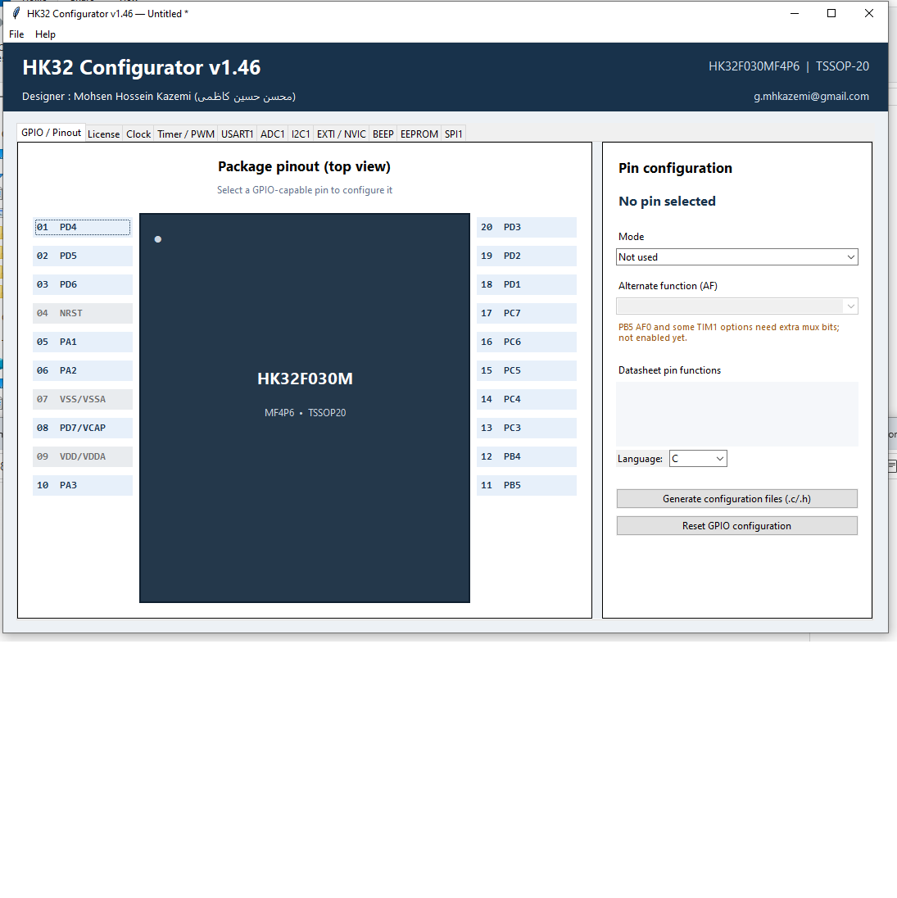
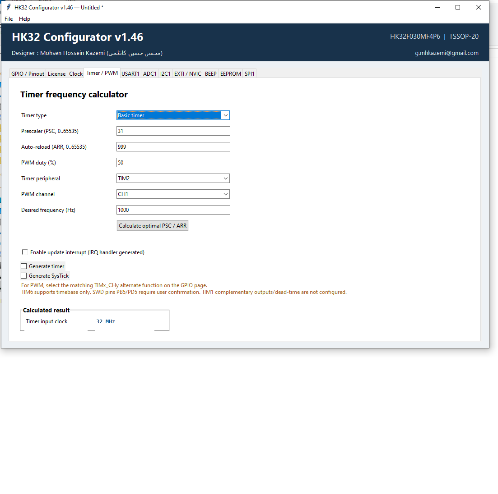
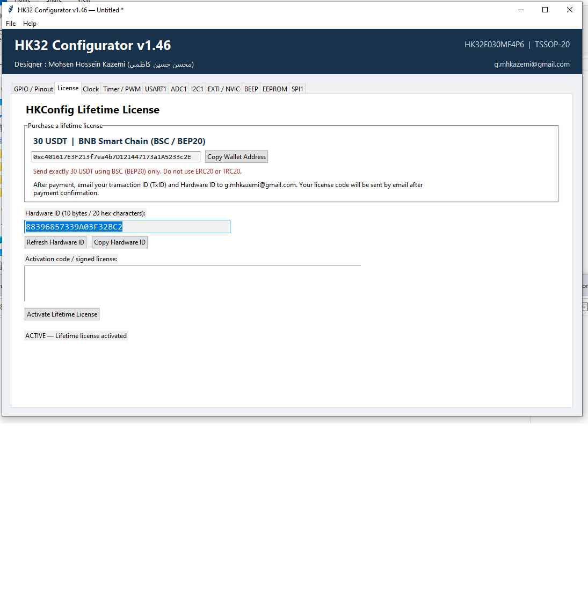

# HK32-Configurator
Professional MCU Configuration and C/C++ Code Generator for HK32F030MF4P6.
# HK32 Configurator v1.46

### Professional MCU Configuration & C/C++ Code Generator

HK32 Configurator is a graphical development tool designed to simplify peripheral configuration and embedded software development for HK32 microcontrollers.

## Supported Microcontroller

- HK32F030MF4P6
- ARM Cortex-M0
- TSSOP-20 Package

## Features

- Graphical Pin Configuration
- Clock Configuration (RCC)
- GPIO Configuration
- SysTick and Delay Functions
- Timers and PWM
- USART Communication
- SPI Communication
- I2C Communication
- ADC Configuration
- EXTI and NVIC Configuration
- EEPROM Support
- BEEP Configuration
- Automatic C/C++ Code Generation
- Peripheral Test Examples
- Project Save and Load
- Integrated English Help

## IDE Compatibility

- Keil MDK-ARM
- IAR Embedded Workbench

## System Requirements

- Microsoft Windows 10 / 11
## Software Screenshots

### Graphical Pin Configuration

### Timer and PWM Configuration

### Lifetime License and Activation

## Download

[Download HK32 Configurator](https://github.com/Mohsenhosseinkazemi/HK32-Configurator/releases)

## License and Activation

**Permanent Single-Computer License: 30 USDT**

- One-time payment
- Offline activation
- Hardware-based licensing

### Payment Information

- Currency: USDT (Tether)
- Network: BNB Smart Chain — BSC (BEP20)
- Wallet Address:

`0xc401617E3F213f7ea4b7D121447173a1A5233c2E`

**Important:** Send USDT using the BSC (BEP20) network only.

After payment, send your Transaction ID (TxID) and Hardware ID to the contact email displayed in the software.

Your license key will be delivered by email after payment confirmation.

## Copyright

HK32 Configurator is proprietary commercial software.

All rights reserved.
